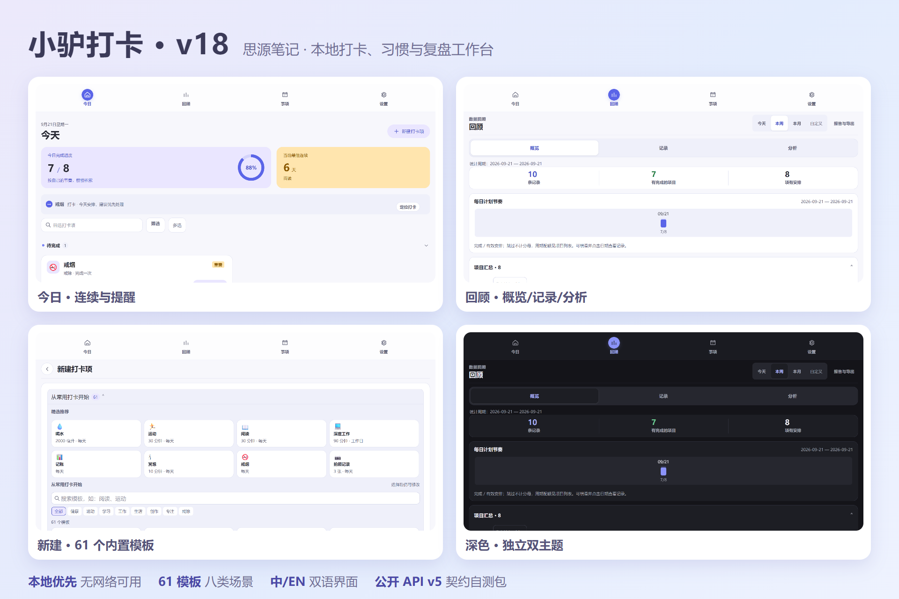

<div align="center">


# 小驴打卡

**思源笔记里的本地优先习惯、打卡与复盘工作台**

把一次行动记录下来，再用同一份可追溯数据完成统计、提醒、复盘和笔记联动。

**当前版本：18.24.0**

18.24.0 达成「健康收件箱一键创建绑定、精力心流区间对账与进度环硬件加速」小版本发布：设置页健康收件箱支持一键快速创建步数与体重打卡项并自动完成映射绑定，实现四大第三方外部联动全量具备零摩擦极简闭环；彻底排查并根治 Review 回顾页精力心流与跳过阻力看板多维筛选下全历史越界统计缺陷，严格对齐当前复盘时间范围契约；Today 仪表盘环形进度条挂载独立合成层与平滑贝塞尔微动效加速。这里介绍本次更新与已实现功能，后续开发进展见 [PROGRESS](PROGRESS.md)。

> **内测说明**：小驴考试、小驴管家、小驴闪卡和小驴常用目前仍处于内测阶段，部分功能和思源宿主兼容性正在验证中。欢迎通过交流 QQ 群 **871707735** 反馈问题、提交需求；对稳定性有较高要求时，请等待对应插件发布正式版。

[](https://github.com/ai68298100/siyuan-checkin/releases/latest) [](https://github.com/ai68298100/siyuan-checkin/actions/workflows/ci.yml) [](LICENSE)

[最新 Release](https://github.com/ai68298100/siyuan-checkin/releases/latest) · [18.24.0 发布说明](docs/releases/release-notes-18.24.0.md) · [问题反馈](https://github.com/ai68298100/siyuan-checkin/issues) · [开发文档](docs/)

</div>

### 本次更新（18.24.0）

本次为「健康收件箱一键创建绑定、精力心流区间对账与进度环硬件加速」小版本，提供健康项目极简闭环与分析范围契约守卫。

新增：健康收件箱一键创建并绑定

- **健康收件箱一键创建并绑定（T-1912）**：设置页健康收件箱行增设“快速创建并绑定”按钮，自动生成步数（6000步）与体重（70千克）项目并完成双向映射，消除逐项配置摩擦。

优化：统计契约范围越界修复与进度环性能

- **精力与阻力分析严格限定当前区间（T-1913）**：修复回顾分析看板在多维筛选下钻时越界读取全历史事件缺陷，严格限定在当前复盘日期范围（`summary.startDate` ~ `summary.endDate`）内。
- **Today 环形进度条 GPU 硬件加速（T-1914）**：为 `.lc-checkin__overview-ring` 注入独立合成层（`translateZ(0)`）与平滑贝塞尔微动效。
- **Today 搜索框极速打卡流（T-1903）**：Enter 键直达 NLP 推荐或聚焦单一匹配卡片，Escape 键一键清空搜索词，严格拦截中文输入法组字态。
- **五级动作按钮语义体系（T-1817）**：落地 Primary / Secondary / Quiet / Destructive / Icon 统一类名、focus-visible 环与高对比度模式轮廓。
- **表单输入高度与文本域 Token（T-1818）**：收敛文本域高度到单一 token，规范校验、禁用与忙碌态视觉。
- **长表单分节与折叠系统（T-1821）**：长表单小节标题增设虚线分隔与加粗样式，收敛高级设置抽屉展开微动效，reduced-motion 平滑降级。
- **宿主容器三档密度（T-1824）**：规范 dock 紧凑档（0.9 / 30px）、tab/quick 标准档（1.0 / 34px）与移动端触控优先档（1.1 / 44px）；移动端输入框聚焦自动注入 96px 滚动保护防止虚拟键盘遮挡。

修复：顶栏渲染稳定性与后台重绘防御

- **彻底根除顶栏图标突然消失（D-522）**：移除 scrollIntoView 父容器纵向滚动外溢，改用纯内部横向滚动计算，顶栏稳固保持在顶部视野。
- **后台定时轮询暴力重绘防御**：检测活动输入焦点控件，用户正在交互时挂起全量重绘至失焦再刷新，杜绝重绘打断与突发重刷。
- **中窄屏顶栏紧凑保留**：放宽 < 720px 规则，440px~719px 保持紧凑模式显示品牌头像与导航图标，避免分屏 Tab 或小弹窗导航全灭。
- **顶栏事件统一闭环与尺寸固化**：在 renderInto 统一收尾处闭环绑定关闭、导航与图标归一，固化顶栏 SVG 固有尺寸为 18px。


<div align="center">

</div>

## 仓库与版本状态

- **稳定安装包**来自 `main` 分支上的发布 tag；普通用户请从 [Releases](https://github.com/ai68298100/siyuan-checkin/releases) 下载，不要直接下载开发分支源码。
- **当前开发**以 `main` 为统一基线；`dev/thispc-1002` 是已合入 `main` 的历史双机开发分支，不作为当前开发线。真实思源客户端验收以兼容矩阵中的现场证据为准。
- **问题反馈**请优先使用 [Issue 模板](https://github.com/ai68298100/siyuan-checkin/issues/new/choose)，安全漏洞请看 [安全报告说明](SECURITY.md)；不要在公开 Issue 中粘贴 Key、Token、笔记内容或完整诊断导出。

[安装与开始](#安装与兼容性) · [核心功能](#核心功能) · [联动与来源](#笔记联动与外部来源) · [接入 API](#api) · [开发与验证](#开发与验证) · [交流](#小驴系列与交流)

## 适合什么场景

小驴打卡适合想在思源里维护习惯、行动记录和复盘资料的人。它支持二值完成、次数、时长、数量、自定义单位和戒除类目标；数据保存在本地，统计和导出不依赖网络或 AI。

插件提供桌面页签、dock、快速弹窗和移动端入口。桌面端可在命令面板执行「打开小驴打卡页签」，或在「设置 → 外观与交互 → 默认打开方式」选择页签：页签可固定在布局、与文档分屏，并随布局重启恢复。移动端使用单列内容、底部导航、安全区和软键盘适配，长内容由回顾、设置等页面自己的滚动区域承载。

## 安装与兼容性

1. 打开 [GitHub Releases](https://github.com/ai68298100/siyuan-checkin/releases)，下载对应版本的 `package.zip`。
2. 在思源中打开“设置 → 集市 → 下载安装包”，选择压缩包安装。
3. 重载插件，从顶栏按钮、命令面板、dock 或移动端入口打开。

插件清单声明的最低兼容版本：思源 v3.8.4。既有自动化真实内核验证基线为思源 v3.8.5；浏览器视觉走查覆盖桌面、移动、窄宽度和双主题，真实客户端证据见[思源兼容矩阵](docs/siyuan-compatibility.md)。

升级前建议从设置页导出 JSON，并核对[备份范围](docs/export-formats.md)。插件不会修改思源内核，也不包含 `kernel.js`、`kernels` 或 `publish.data` 声明。

### 第一次使用

1. 在「新建」选一个模板，或填写名称、目标、单位和计划，保存项目。
2. 回到「今日」完成一次记录；数量或时长项目可用快捷增量，也可输入精确值。
3. 在「回顾」核对记录，再查看日、周或月统计。需要连接日记或外部来源时，再到「设置」选择目标并启用对应联动。

## 核心功能

| 页面 | 可以做什么 |
| --- | --- |
| **今日** | 按分组、优先级和搜索查看今日机会；一键完成、`+1`、快捷增量、精确记录、跳过、撤销和拖动排序。已完成区域支持展开/折叠。「那年今天」回顾往年同日的打卡与事项。 |
| **回顾** | 查看日/周/月/自定义范围的总结、趋势、热力图、日志、强度、周期对比、成就、提醒和行动建议；可导出 JSON、CSV、Markdown 与年度分享图。 |
| **洞察** | 查看单个项目的完成、连续记录与趋势，按日期钻取记录或返回编辑规则。 |
| **新建** | 配置类型、目标、单位、计划、步长、时间段、来源、分组和图标；内置模板、最近使用、场景组合包和“我的模板”可直接复用。按名称智能联想模板与字段；「步数/体重/阅读/问卷日记」模板提供联动绑定建议；推荐位按已有项目动态生成互补建议；支持空状态一键装填与「保存并继续」。 |
| **日期事项** | 管理生日、纪念日、账单、续费、节日等一次性、周期或农历事项；纪念日自动派生「满 N 天/个月/周年」里程碑与自然历跨度，长周期事项显示本周期进度；支持单次改期与错过补标记；可查看逾期、即将到来的提醒和「那年今天」回顾。 |
| **归档** | 搜索、恢复或删除不再参与今日计划的项目；归档不会删除历史事件。 |
| **设置** | 管理主题、语言、减少动效、默认打开方式、日记/笔记联动、第三方来源、备份恢复、诊断、审计和显示偏好。 |

### 18.17.4 重点

- **滚动更顺畅**：Today 长列表启用延迟绘制，短横屏保持按钮可命中。
- **布局更稳定**：头像、日志附件和历史缩略图声明尺寸，加载时减少跳动。
- **安全不变**：图片仍经过安全 URL 校验，现有数据和交互协议保持兼容。

### 18.17.2 重点

- **提醒不遮挡**：可见 surface 使用页面文流，Today、编辑器和事项内容保持可见。
- **负荷位置**：未来七天负荷放在主任务区域下方，宽屏信息层级更清晰。
- **短屏可操作**：提醒收敛为 64px，预览、长文本和保存操作仍可到达。
- **入口一致**：More、设置健康卡和快速弹窗记录入口保持统一返回上下文。

<details>
<summary>历史版本更新（点击展开）</summary>

### 18.18.0

「可信行动事实层与生态连接里程碑」大版本：收口 Task Horizon 合作提供端协议（C-01~03、W-03），彻底消除跨时区与夏令时跨度漂移，全面落地多 root 跨表面交互隔离与表单草稿保护，统一写入幂等与隐私脱敏矩阵。详见 [18.18.0 发布说明](docs/releases/release-notes-18.18.0.md)。

### 18.17.6

完善恢复、跨窗口与外部批量写入的可靠性，并修正回执折叠和状态对比度。详见 [18.17.6 发布说明](docs/releases/release-notes-18.17.6.md)。

### 18.17.5

现代桌面质感与 UI 原型 v3 对齐：Today Hero 下一步行动卡、Settings Bento 健康总览、卡片高光与阴影、等宽数字、减少动效适配及部分图标与字号治理。详见 [18.17.5 发布说明](docs/releases/release-notes-18.17.5.md)。

### 18.17.1

全插件功能与 UI 复核后的可靠性和体验补丁。

- **失败可恢复**：偏好、来源待处理、恢复点和记录回执以持久化结果决定成功，失败保留重试入口。
- **页面隔离**：多窗口同屏时，排序、导航、焦点和异步反馈归属于发起页面。
- **反馈与输入边界**：补齐忙碌状态、键盘与双语反馈，严格日期和 CSV 校验，公开 API 快照和重复回执更稳定。

### 18.17.0

「双机合并后的事项工作台、微信读书推荐与跨表面可靠性收口」版本。主存储、公开 API v5、最低思源版本和既有导入格式保持兼容，可直接从 18.16.0 升级。

- **微信读书推荐**：根据已读取的来源事实生成分钟项目与阈值建议，预览与应用分离，只有用户明确点击才写入设置。
- **事项工作台**：支持重复/相似名称确认、规则预览、排序、单次改期与冲突提示、逐次完成、提醒状态和关联打卡项目跳转。
- **跨表面可靠性**：事项、快速弹窗、今日记录和设置状态按 root 隔离，草稿、失败回执、提醒动作和导入回滚可恢复。
- **无障碍与多端**：补齐键盘日期导航、焦点恢复、移动端表单定位、读屏状态和多窗口生命周期保护。

### 18.16.0 历史重点

- **事项页表单**：移动端打开表单直接定位，桌面端保留当前位置。
- **文档与笔记本选择**：问卷和叶归配置使用统一的搜索与候选列表，目标卡在宽窄容器均保持单列。
- **CSV 导入错误明细**：导入时无效行返回行号与原因（名称缺失/日期无效/数值无效），上限前 10 条。
- **设置页字体**：统一标题、分组和说明的层级，减少视觉噪声。

历史版本重点见 [发布说明目录](docs/releases/) 与 [18.14.0 变更记录](docs/v18.14.0-change-log.md)。

</details>

## 记录、统计与导出

支持的项目类型：

- 完成一次：点击即可记录一次二值完成；
- 按次数、时长、数量或自定义单位：支持手动精确值、快捷增量和可选专注计时；
- 戒除类目标：不记录即成功，记录即破戒，连续无破戒日按同一模型计算。

计划支持每天、工作日、指定星期、间隔天数和周期配额。跳过日、自动完成日、配额和 at-most 目标各有独立统计口径。

回顾页提供原始事件日志、统计摘要、连续记录、热力图、强度趋势、周期对比、相关性洞察、成就和建议。导出前会披露可能包含的备注、图片或来源信息；导出的文件由用户自行保存和传输。

可用的迁移与备份通道包括 JSON、CSV、Markdown 报告、Loop Habit Tracker 和 Obsidian Habit Tracker 21。格式和身份规则见[导出与导入格式总览](docs/export-formats.md)及[记录身份与多端合并规则](docs/identity-and-merge.md)。

## 笔记联动与外部来源

日记报告、摘要驻留、问卷日记、笔记锚点、叶归 LifeLog、思阅、思播、健康和微信读书均为可选联动。设置 → 外部联动中的“笔记联动总览”集中列出绑定目标类型、目标 ID、启用状态和本次会话的健康检查结果，并提供打开目标或跳到配置的入口。

所有外部来源默认关闭；Key、目标 ID 和映射只保存在本地偏好。断开来源不会删除已经落盘的事件，重新连接仍按 `source + externalRef` 幂等去重。提醒中心是插件内呈现，不承诺系统级后台通知；插件不提供云同步、社交排行榜或付费补签。

## API

插件通过 `window.siyuanCheckin` 公开协议 `siyuan-checkin`，API 版本为 5。接入方应先等待就绪，再按能力协商：

```js
const checkin = window.siyuanCheckin;
await checkin.whenReady();

if (checkin.hasCapability("events.record")) {
  await checkin.recordEvent({
    itemId: "item-id",
    value: 25,
    unit: "分钟",
    source: "api",
    externalRef: "my-plugin-session-2026-001",
  });
}
```

主要能力包括 `items.read`、`items.query`、`events.read`、`events.range.read`、`events.record`、`events.record.batch`、`summary.read`、`analytics.read`、`metrics.read`、`diagnostics.read`、`export.json`、`export.csv`、`focus.adapters` 和 `summary.providers`。写入必须由用户明确触发；批量写入、外部身份和日期范围均有上限与校验。

完整字段、能力版本和安全边界见 [API v5 参考](docs/api-v5.md)、[生态集成契约](docs/ecosystem-integration.md) 和 [Task Horizon 合作契约](docs/checkin-taskhorizon-cooperation.md)。第三方可以先运行[契约自测包](contracts/siyuan-checkin-contract/)。

## 数据安全、主题与无障碍

- 主存储、恢复点、审计、事项、模板、图标、提醒动作和分析历史分开保存；事件使用稳定 ID，外部事件使用幂等身份。
- 导入先预检和迁移校验，恢复失败会回滚内存状态并保留诊断信息；删除、批量删除和来源断开会说明影响范围。
- 设置提供跟随思源/浅色/深色三种主题、弹窗尺寸、减少动效和显示偏好重置。插件使用独立的淡紫蓝画布、白卡和紫罗兰强调色。
- 主要按钮、输入和移动导航遵循 44px 触控基线；焦点、`aria` 状态、`hidden` 状态和颜色之外的冗余编码一起维护。

## 开发与验证

环境要求：Node.js 20.19.0+、pnpm 12.5.1（`package.json` 已固定版本）。

```bash
corepack pnpm install
corepack pnpm run check          # TypeScript 类型检查
corepack pnpm test               # 领域、迁移、生态和交互测试
corepack pnpm run test:ui        # UI、响应式、文档和稳定性守门
corepack pnpm run test:mobile    # 移动端布局、键盘、旋转和触控守门
corepack pnpm run test:ecosystem # API、事件和外部联动守门
corepack pnpm run test:perf      # 大量事件和投影性能基线
corepack pnpm run benchmark:storage # 主 Store 快照写放大观测（不设发布门槛）
corepack pnpm run benchmark:storage:host # 显式真实思源宿主快照/并发/失败重载观测
corepack pnpm run build          # 生产构建，输出 dist/ 与 package.zip
corepack pnpm run test:quality   # 发布前完整质量链
```

视觉和宽度走查默认使用 Playwright 安装的 Chromium。需要指定本机浏览器时可设置 `CHECKIN_BROWSER`；下面是 PowerShell 示例：

```powershell
$env:CHECKIN_BROWSER = "C:\path\to\chrome.exe"
node tests/visual-qa.cjs
$env:CHECKIN_QA_THEME = "dark"
node tests/visual-qa.cjs
node tests/width-walkthrough.cjs
```

真实思源内核 E2E 会创建带 `checkin-e2e.json` 标记的隔离工作区，不接触用户笔记本：

```bash
corepack pnpm run test:e2e
corepack pnpm run test:e2e:readonly
```

真实宿主快照基准必须另外提供独立的 `CHECKIN_E2E_WORKSPACE`、`SIYUAN_TOKEN` 和可用端口（可用 `CHECKIN_E2E_PORT` 覆盖默认端口）；它会运行 1k/10k/100k 样本、双窗口并发和受控写失败重载夹具，结果写入 `.artifacts/storage-host-benchmark*.json`，不属于发布硬门槛。

完整路线见[当前开发状态](docs/development-roadmap-current.md)和[自动化证据报告](docs/automation-evidence-report-2026-09.md)。

## 已知边界

- 浏览器和隔离内核可以发现结构、样式和数据回归，但不能替代真实思源客户端的宿主生命周期、系统键盘、安全区、页签/dock 和多窗口验收。
- 「那年今天」的往年日记跳转依赖思源自动写入的 dailynote 属性；由其他工具创建且缺少该属性的日记会提示未找到，不会误建文档。
- 思阅、思播、健康、微信读书和叶归的真实账号、Key、笔记本及上游版本需要用户在目标环境中实测；插件会在来源不可用时保持手动路径可用。
- 底栏番茄钟联动依赖上游公开兼容 API；兼容版本未安装时请使用内置计时或手动记录。
- 智能体能力依赖思源宿主公开 API，默认只读；没有模型时本地记录、统计、导入导出仍可用。

## 文档入口

- [发布说明目录](docs/releases/) · [发布与回滚](docs/release-rollback.md) · [思源兼容矩阵](docs/siyuan-compatibility.md)
- [API v5](docs/api-v5.md) · [生态集成契约](docs/ecosystem-integration.md) · [契约自测包](contracts/siyuan-checkin-contract/) · [真机验收清单](docs/integration-smoke-checklist.md)
- [贡献指南](CONTRIBUTING.md) · [安全报告](SECURITY.md) · [仓库运维说明](docs/github-repository-ops.md)
- [架构与模块地图](docs/architecture.md) · [仓库布局规则](docs/repository-layout.md) · [导入导出格式](docs/export-formats.md)
- [低压力呈现基线](docs/low-pressure-baseline.md) · [笔记绑定盘点](docs/note-bindings-inventory.md) · [生态调研记录](docs/benchmark-habit-apps-2026-09.md)
- [当前路线](docs/implementation-roadmap-product-strategy-2026-09.md) · [UI 内容审查记录](docs/ui-full-content-audit-2026-09-20.md) · [UI 变更记录](docs/v4.0-ui-change-log.md) · [UI 路线归档](docs/archive/ui-product-roadmap.md)
- [产品定位与下一阶段路线](docs/product-positioning-and-roadmap-2026-10.md) · [UI 原型 v3](docs/prototypes/checkin-ui-v3.html) · [v3 完整设计规范](docs/ui-prototype-spec-v3-2026-10.md)
- [v2.0 变更记录](docs/v2.0-change-log.md) · [v2.0 迁移说明](docs/v2.0-migration-notes.md) · [旧版 UI 路线](docs/archive/ui-redesign-roadmap.md)

## 小驴系列与交流

小驴系列插件各自独立，可按需安装和组合使用：

| 插件名称 | 一句话简介 | GitHub 仓库 |
| --- | --- | --- |
| [小驴雷切](https://github.com/ai68298100/siyuan-speed-switch) | 思源中的统一导航与工作上下文平台，连接页签、工作台、片段和快捷入口。 | [ai68298100/siyuan-speed-switch](https://github.com/ai68298100/siyuan-speed-switch) |
| [小驴打卡](https://github.com/ai68298100/siyuan-checkin) | 本地优先的习惯、目标打卡与复盘工作台。 | [ai68298100/siyuan-checkin](https://github.com/ai68298100/siyuan-checkin) |
| [小驴人脉](https://github.com/ai68298100/siyuan-contacts) | 在思源中管理联系人、人际关系、组织归属和重要日期。 | [ai68298100/siyuan-contacts](https://github.com/ai68298100/siyuan-contacts) |
| [小驴拾遗](https://github.com/ai68298100/siyuan-glean) | 整理思源剪藏和导入文章，支持状态分拣、阅读管理与日后回顾。 | [ai68298100/siyuan-glean](https://github.com/ai68298100/siyuan-glean) |
| [小驴考试（内测版）](https://github.com/ai68298100/siyuan-exam) | 本地题库备考工作台，支持多格式导入、刷题、模考、错题复盘与 AI 辅助。 | [ai68298100/siyuan-exam](https://github.com/ai68298100/siyuan-exam) |
| [小驴管家（内测版）](https://github.com/ai68298100/siyuan-home) | 管理家庭与生活资料、成员档案、台账、到期提醒和事务跟进。 | [ai68298100/siyuan-home](https://github.com/ai68298100/siyuan-home) |
| [小驴闪卡（内测版）](https://github.com/ai68298100/siyuan-lv-cards) | 思源中的知识捕获、制卡、练习与复习平台，使用内核原生 FSRS 排期。 | [ai68298100/siyuan-lv-cards](https://github.com/ai68298100/siyuan-lv-cards) |
| [小驴常用（内测版）](https://github.com/ai68298100/xiaolv-common) | 基于思源块保存、搜索并快速调用常用语、模板、代码和链接，支持变量填充。 | [ai68298100/xiaolv-common](https://github.com/ai68298100/xiaolv-common) |

交流 QQ 群：**871707735**（反馈问题、提交需求、交流使用体验）。反馈问题时请附上插件版本、思源版本、操作步骤和出现问题的页面。

## License

[MIT](LICENSE)

